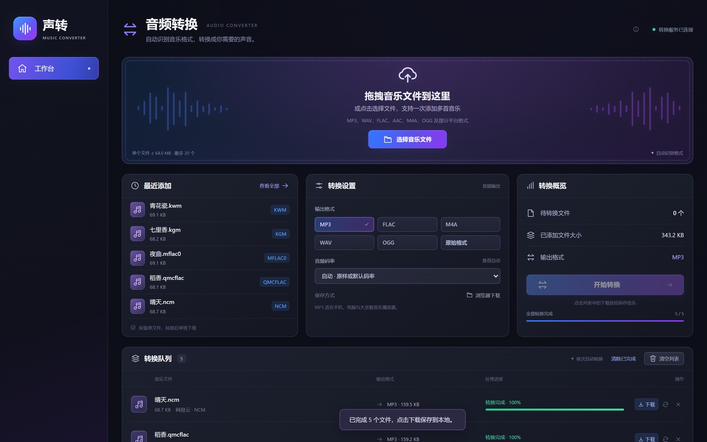

<div align="center">

# 声转 · 音乐转换器

**上传本地音乐，自动识别格式，换成你想要的声音。**

网易云 NCM · QQ 音乐 QMC · 酷狗 KGM · 酷我 KWM · 常见音频格式，一个网页全部搞定

`Python 3.10+` · `FastAPI` · `FFmpeg` · `Windows / Web` · `MIT` · 纯本地运行



</div>

---

## 这是个什么项目

同一个音乐文件，在不同场景下可能要不同格式：车机只认 MP3、素材库要 WAV、归档想留无损。
**声转**是一套本地运行的转换工具，两条入口共用同一套转换内核：

- **网页版**（推荐）：拖文件进浏览器 → 自动识别 → 选格式 → 下载。手机宽度也能用。
- **桌面版**：Windows 原生窗口，支持资源管理器拖放、批量导入整个文件夹。

转换全程不联网、不登录任何音乐平台，**不上传歌曲到第三方，也不改动原文件**。

## 功能

| 能力 | 说明 |
|---|---|
| **上传即识别** | 不按后缀猜格式，读文件头、文件尾和还原后的音频头；后缀改错照样识别 |
| **四平台默认接通** | 网易云、QQ 音乐、酷我、酷狗的受支持版本开箱可转，客户不需要填任何参数 |
| **六种输出** | MP3 / FLAC / M4A / WAV / OGG / 保留原始编码 |
| **同编码不重编码** | 源编码与目标一致时直接复制音频流，音质零损失，速度接近秒出 |
| **保留标签与封面** | 标题、歌手、专辑、JPEG/PNG 封面尽量带到 MP3、FLAC、M4A |
| **批量队列** | 依次转换、实时状态、可停止、单条重试；多选结果可打包成 ZIP |
| **深色工作台** | 桌面与手机自适应，纯原生前端，无构建步骤 |

## 支持范围

> ⚠️ 平台格式各有多个版本，**这里写的是"实测能转的范围"，不是"全部都能转"。**
> 遇到不支持的版本会明确告诉你原因，不会给一个打不开的 MP3。

| 平台 | 默认支持 | 暂不支持自动转换 |
|---|---|---|
| 网易云音乐 | 常见 `.ncm`（内层 MP3 / FLAC，含中文标签与封面） | 非 NCM 的其他网易云缓存、未知变体 |
| QQ 音乐 | QMC v1；QMC v2 的长度尾、QTag、EncV2（Map 与 RC4 两种内层） | STag、musicex、缺少可恢复内嵌密钥的版本 |
| 酷狗音乐 | `.kgm` / `.kgma` / `.vpr` 的 **type 2、type 3、slot 1**（校验文件签名） | type 4、未知 type、未知 slot |
| 酷我音乐 | `.kwm` 标准头，自动尝试 32/64 位种子并验证音频 | 其他封装或解码后不是有效音频 |
| 普通音频 | MP3、FLAC、WAV、M4A/AAC、ALAC、OGG、Opus、APE、WMA、AIFF、DSD、WavPack、TTA 等 | —— |

判定"支持"的标准是**真的解出了可播放音频**：结构识别只是候选，还要通过签名、音轨和完整解码校验。

## 快速开始

### 1. 准备 FFmpeg

把 `ffmpeg.exe` 与 `ffprobe.exe` 放进项目的 `bin/` 目录，或确保它们在 `PATH` 中。
Windows 可从 [Gyan FFmpeg Builds](https://www.gyan.dev/ffmpeg/builds/) 下载 essentials 压缩包。

### 2. 安装依赖

```powershell
python -m pip install -r requirements-server.txt
python -m pip install --require-hashes --target .deps -r requirements-adapters.txt
```

第二条装的是平台格式的**可选适配器**，只写进项目内的 `.deps/`，不污染系统 Python。
也可以直接双击 `Install-Adapters.bat`。

### 3. 启动

**网页版**

```powershell
python -m server
```

打开 <http://127.0.0.1:8787/>，拖文件、选格式、点开始即可。也可以双击 `Start-Backend.bat`。

**桌面版**

```powershell
python app.py
```

或双击 `Start.bat`。

界面细节、环境变量和部署注意事项见 [后端接入.md](后端接入.md) 与 [使用说明.md](使用说明.md)。

## 工作原理

```
浏览器 ──POST 原始字节──▶ /
                          ├─ /api/v1/inspect   只识别，不动文件
                          └─ /api/v1/convert   识别 → 提取 → 转码 → 返回音频
                                   │
                    ┌──────────────┼───────────────┐
                    ▼              ▼               ▼
               普通音频       平台封装          不支持
             （ffprobe）   （文件头/尾 +       （说明原因）
                            按版本选读取器）
                    │              │
                    └──────┬───────┘
                           ▼
                 FFmpeg 转码 / 复制音频流
                           ▼
              输出校验 → 原子发布 → 下载
```

几个关键设计：

- **服务端配置只读一次**：共享参数在启动时加载，客户端无法用请求覆盖，也就不存在"上传一个 JSON 改服务器行为"。
- **临时目录隔离**：每个请求独立目录，下载完成、失败或断开后清理。
- **输出先验证再返回**：产物必须能被 ffprobe 解析且编码正确，否则一律当失败处理，不返回半成品。

## HTTP API

| 方法 | 路径 | 用途 |
|---|---|---|
| GET | `/healthz` | FFmpeg / ffprobe 是否就绪 |
| GET | `/api/v1/capabilities` | 支持的输出格式、码率与大小限制 |
| POST | `/api/v1/inspect?filename=歌名.ncm` | 只诊断，返回状态与原因 |
| POST | `/api/v1/convert?filename=歌名.ncm&format=mp3` | 直接返回音频附件 |

请求体是**原始文件字节**（`Content-Type: application/octet-stream`），不是 JSON 或表单。
转换失败统一返回 `{"error":{"code":"…","message":"…"}}`，常见 code 有
`needs_server_config`、`requires_file_key`、`unsupported_format`、`conversion_failed`、`upload_too_large`。

## 本地测试

测试**不需要真实歌曲，也不需要任何平台账号**：脚本会现场生成单音调，封装成各平台格式，再跑完整链路。

```powershell
$env:REQUIRE_ADAPTERS = '1'
python -m unittest -v tests.test_converter tests.test_server tests.test_ncm_defaults `
    tests.test_platform_defaults tests.test_vendor_readers
```

覆盖内容：

- 普通音频与视频容器、误改后缀、截断文件、播放列表伪装
- 四个平台的默认识别与真实转码，原音频包哈希逐字节比对
- 错误密钥、损坏签名、未知版本、STag / musicex 等不支持边界
- 上传与产物大小限制、并发上限、超时取消、临时目录清理
- 网页端到端：真实浏览器上传、MP3 下载、ZIP 打包、手机布局

网页交互测试（可选，需要 Playwright 与本机浏览器）：

```powershell
python -m tests.browser_smoke
```

## 目录结构

```
music-converter/
├─ web/                 纯静态前端（HTML/CSS/JS，无构建）
├─ server/              FastAPI 服务：路由、配置、启动
├─ core/                转换内核
│  ├─ probe.py          格式识别与判定
│  ├─ convert.py        FFmpeg 调度、输出校验与原子发布
│  ├─ platforms.py      封装解析与版本选择
│  ├─ vendor_readers.py 酷狗 T2/T3 读取器
│  ├─ mask_reader.py    酷我 KWM 读取器
│  └─ default_profiles.py 公开格式默认参数
├─ app.py               Windows 桌面版
├─ tests/               合成样本与回归测试
├─ licenses/            第三方许可证原文
├─ LICENSE              本项目 MIT 许可
└─ THIRD_PARTY.md       来源与许可说明
```

## 限制说明

- **必须自带 FFmpeg**：仓库不分发二进制，请按上面步骤准备。
- **平台格式会变**：厂商更新封装后，某些版本可能失效。遇到时项目会报"暂不支持"，而不是崩溃或产出坏文件。
- **默认限额**：单文件上传 64 MiB、产物 128 MiB、并发 2，可用环境变量调整（见 [后端接入.md](后端接入.md)）。
- **这是本机版本**：默认只监听 `127.0.0.1`。若要对外提供服务，还需补 HTTPS、鉴权、限流和隔离运行环境。
- **桌面版仅 Windows**：网页版跨平台，但桌面版的拖放与部分交互依赖 Windows API。

## 许可

本项目自身代码以 **MIT** 许可发布——可以自由使用、修改、分发，包括商用，保留版权与许可声明即可。

**一个例外**：`core/vendor_readers.py` 与 `core/mask_reader.py` 是从
[MusicDecrypto](https://github.com/davidxuang/MusicDecrypto) 移植的读取器，沿用 **LGPL-2.1-or-later**。
这两个文件是自包含模块，可以单独替换或删除；它们的上游版本、修改说明和许可证原文都在
[THIRD_PARTY.md](THIRD_PARTY.md) 与 [licenses/](licenses/) 中。

### 第三方组件

平台格式的读取依赖若干公开实现，固定版本与许可证如下：

| 组件 | 版本 | 许可 |
|---|---|---|
| [libtakiyasha](https://github.com/nukemiko/libtakiyasha)（NCM / QMC 解析） | 2.1.1.post1 | MIT |
| [MusicDecrypto](https://github.com/davidxuang/MusicDecrypto)（酷狗 / 酷我读取器移植） | b97bedc0 | LGPL-2.1-or-later |
| [qmc-decoder](https://github.com/presburger/qmc-decoder)（QMC v1 参数） | fb1e04b | MIT |
| [ncmdump](https://github.com/taurusxin/ncmdump)（NCM 默认参数） | 1.5.1 | MIT |
| [pyaes](https://github.com/ricmoo/pyaes) | 1.6.1 | MIT |
| [Mutagen](https://mutagen.readthedocs.io/) | 1.47.0 | GPL-2.0-or-later |
| [FFmpeg](https://ffmpeg.org/legal.html) | 按本机构建 | 视构建而定 |

依赖通过 pip 单独安装、以独立进程或模块形式调用，未与项目代码打包成单一可执行文件。
MIT 许可不影响这些组件各自的许可条款。

## 免责声明

- 本项目**仅供个人学习与本地文件处理**，请只处理**你有权转换**的音频文件。
- 它**不提供任何音乐获取渠道**：不联网抓歌、不搜索、不下载、不共享曲库，也不托管任何音频内容。
- 它不绕过账号、付费或登录验证；代码中的平台格式参数来自已公开的第三方实现（见 [THIRD_PARTY.md](THIRD_PARTY.md)）。
- 使用前请自行确认符合你所在地区的法律与所用平台的服务条款。作者不对使用者的行为及后果承担责任。
- 「支持」仅指技术上的可行性，不构成对任何用途的许可或背书。

如果你只是想要格式转换，不需要平台封装的支持，可以删除 `core/vendor_readers.py`、`core/mask_reader.py`
以及 `core/default_profiles.py` 中的平台默认值，项目其余部分（转码、批量、网页与桌面界面）仍可正常工作。
